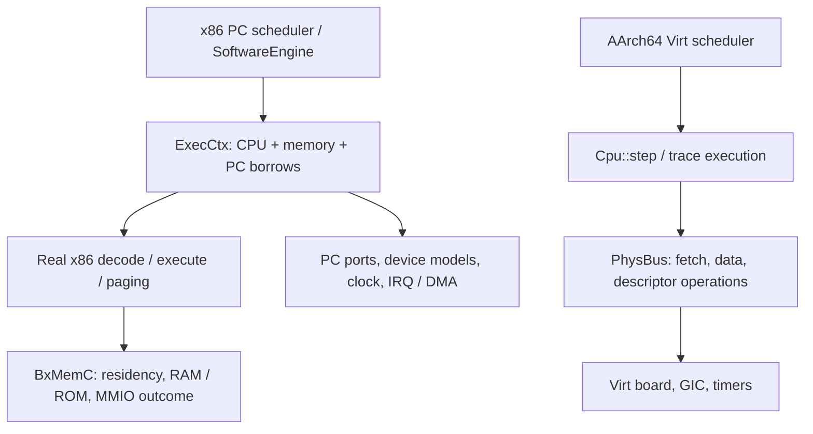

# vNext Phases 0–2: real x86 CPU-only boundary

This patch adds a crate-private path through the **existing x86 interpreter** with only a processor and memory. It constructs no `BxDevicesC`, `DeviceManager`, `BxPcSystemC`, BIOS, PCI bus or PC machine. It is an incremental implementation, not a completed vNext API. AArch64 source is unchanged.

## 1. Repository baseline and source findings

- Base: `master`, `d0fb51225ef49baee4cc0b36e2c4d43b28ebcef6` (Merge pull request #4 from r3bb1t/dev).
- Work branch: `codex/vnext-x86-cpu-only`. No remote write or PR.
- Read the complete attached *Composable Emulation Architecture* brief and `docs/safety-doctrine.md` before editing.
- Compiler installed in this workspace: rustc **1.100.0** (`0ef1bc386`, LLVM 23.1.5), x86_64-unknown-linux-gnu. Nightly formatting uses 1.102.0-nightly (`59cbdee2e`). Host reports AMD EPYC 9V45; shared virtualized environment with no frequency control. Initial timings were unpinned; the longer comparison pins both binaries to the first CPU allowed by the host.
- Baseline: `cargo test --release -p rusty_box --lib --no-default-features --features std`: **1,029 passed**, 0 failed (3.48 s tests, compilation excluded).

Baseline dependencies, established from the live source:



The x86 instruction implementation is already on borrowed `ExecCtx`, with CPU-only methods reached through `Deref`. Its required PC borrows were concentrated in `cpu.rs`, `io.rs`, `event.rs`, `exception.rs`, and the clock reader in `proc_ctrl.rs`. The ISA-wide handler implementations did not need a new type parameter.

`ExecCtx` derives identity-RAM and whole-allocation bases together and calls `adopt_backing`. Data TLB offsets and instruction/fetch offsets use different units. Fetch consumes residency epochs in `get_icache_entry`; physical stores, host loads and DMA enqueue shared SMC invalidations. These mechanisms were retained. The PC's A20/SMRAM routing and event reconciliation remain in the existing paths.

ARM is materially different: `Cpu::step<B: PhysBus, I: Instrumentation>` builds `Observed`; fetch and descriptor reads bypass data observation, and descriptor swaps hold an exclusive bus borrow. `FetchSource::Stable(CodeEpoch)` distinguishes cacheable fetch from volatile devices. `VirtMachine::run_slice` coordinates GIC delivery, timers, bursts and trace execution. GIC system-register methods on `PhysBus` are ARM-specific, so this patch does not turn it into a global memory trait. `rusty_box_core::machine::Machine` remains the interactive serial/keyboard surface.

The x86 core already supports no_std/no_alloc configuration, but that is not a small footprint claim: CPU caches are fixed large arrays, the memory model includes a 4 MiB BIOS area plus extension-ROM/bogus-page storage, and caller placement remains necessary without alloc. The std memory path owns a temporary overflow file even when no swapping is needed.

## 2. Two boundary candidates

| Candidate | Decision and evidence | Safety, cost and extensibility |
|---|---|---|
| Split memory from a private PC-hardware loan in the existing `ExecCtx` | **Selected and implemented.** Named `CpuMemory` projection; internal `Hardware::Pc` / `CpuOnly`. Changes concentrate in actual platform consumers. | Ordinary disjoint borrows; same backing-adoption door; no new trait, allocation, unsafe memory operation or indirect RAM dispatch. Hardware-mode checks occur at platform operations and slice entry. The internal closed enum is migration machinery, not a third-party device registry. Memory backend remains concrete. |
| Parameterize `ExecCtx` over a narrowly typed x86 resource provider | **Rejected for this patch**, not prototyped or timed. Inspection found `ExecCtx` impls across most ISA handler files; a new resource parameter/bound would spread into those implementations before proving a memory contract. | Could later statically specialize platform paths and allow external providers. Today it brings broad generic churn, potentially more monomorphized code, and still must specify backing identity, epochs, residency and faults. An unconstrained pointer-returning memory trait would be unsound. |

ARM keeps its own internals and bus semantics. Future ISAs need not implement this x86 migration enum. Universal processor/environment traits, public CPU-machine constructors, event frameworks and topology macros remain deferred.

## 3. Actual code changes

- `cpu/exec_ctx.rs`: CPU and `BxMemC` remain separate borrows; PC-only services move into a private hardware loan. `cpu_only` rejects registered PC MMIO before execution. Both profiles use `assemble` for backing adoption. `cpu_memory` replaces the internal four-tuple; `cpu_with_io` lends the full PC loan only when present.
- `cpu/cpu.rs`, `event.rs`, `exception.rs`, `proc_ctrl.rs`: retain PC clock, DMA, PIC and reset operations behind their real resource projection. Minimal execution uses CPU-local ticks, has no DMA/PIC inputs, and exposes architectural shutdown on triple fault instead of attempting to reset a nonexistent board. Deferred LAPIC bus/timer/CPU-control work returns a typed `MachineBoundaryUnavailable` exit with its latch intact. Unlike port-I/O exits, these machine-work exits retain committed RIP and instruction counts; a real guest broadcast-IPI test proves both retirement and retry behavior.
- `cpu/io.rs`, `error.rs`: absent port resources produce `IoUnavailable` **after architectural privilege/intercept checks and before port or string-memory effects**. The loop rewinds the speculative IP advance without incrementing `icount`. Retry reaches the same instruction. Empty REP still checks privilege, then completes without a provider. Nonempty string I/O exits before its first iteration; partial REP host completion is unimplemented. Port helpers propagate errors instead of synthesizing a successful input or output.
- `memory/memory_stub.rs`: safe `from_buffer(&'static mut [u8], ...)` supports caller-owned, aligned backing. The existing raw constructor forwards through it; initialization and geometry validation remain shared. No additional unsafe operation, allocation policy or external backend trait is introduced.
- The public additions are `BxMemoryStubC::from_buffer` and the two x86 error variants (`IoUnavailable`, `MachineBoundaryUnavailable`); downstream exhaustive `CpuError` matches need corresponding arms. The vNext execution types remain internal.
- Tests exercise real instruction bytes, both profiles, faults, I/O restart, code writes, backing replacement, residency changes and supplied storage. A downstream integration test and compile-fail fixture cover the storage API and exclusive loan.

This deliberately leaves the execution seam crate-private. Downstream callers can provide backing safely, but **cannot yet implement an arbitrary x86 memory backend or construct a public CPU-only machine**. The new tests do not pretend that supplying storage satisfies that stronger extension requirement.

## 4. Validation and performance

| Command | Result |
|---|---|
| `cargo test --release -p rusty_box --lib --no-default-features --features std` | **1,044 passed**, 0 failed; one manual timing test ignored. Includes 15 new CPU-only regressions. |
| `cargo test --release -p rusty_box --no-default-features --features std --test borrowed_backing --test compile_fail` | Two downstream runtime tests passed; all five compile-fail fixtures passed. Only the new fixture's reviewed E0506 golden was added; existing goldens were unchanged. |
| `cargo test --release -p rusty_box_aarch64 --no-default-features --features std` | **1,049 library tests passed**, 8 AARCHMRS-dependent tests ignored; every integration/doc-test group passed. |
| `cargo check -p rusty_box --no-default-features --lib --target x86_64-unknown-none` | Passed: no_std/no_alloc core. |
| `cargo check -p rusty_box --no-default-features --features alloc --lib --target x86_64-unknown-none` | Passed. |
| `cargo check -p rusty_box --no-default-features --features alloc --lib --target wasm32-unknown-unknown` | Passed. |
| `cargo check --release -p rusty_box_no_alloc_smoke` | Passed. The host debug-profile version fails for unsupported no_std panic unwinding on **both baseline and patch**; no production fix was necessary. |
| `cargo test --release -p rusty_box --no-default-features --test borrowed_backing --test no_std_memory` | **4 passed** with the library built without std or alloc. |
| `cargo test --release -p rusty_box --no-default-features --features std --test api_examples --test prefetch_window_wrap --test itlb_large_page_invlpg --test stack_rollback --test shadow_stack_rollback --test v8086_interrupt` | **56 passed** across those six integration binaries. |
| `cargo +nightly fmt --all -- --check` | Passed. |
| R9 mutation check | In a separate worktree, deliberately charging one `icount` on `IoUnavailable` made `cpu_only_scalar_io_exit_is_before_retirement_and_repeatable` fail (1 versus 0). The mutation was removed; the work branch was never mutated. |

The CPU-only tests cover flat protected 32-bit execution, real-mode guest-fault delivery, and **64-bit execution with real paging and caller-installed translation tables**. The I/O tests also prove architectural privilege failure precedes an absent-provider exit. A late source review found the separate post-retirement machine-work case; the patch now reports it explicitly and tests it with an actual LAPIC ICR write, rather than treating it as an ordinary successful slice. The minimal fixture resets the processor before selecting its execution mode. Its privilege regression installs real ring-3 GDT/IDT entries and observes the saved fault frame; the PC resume test uses the scheduler because a port write can end a slice for machine-wide effects.

The private CPU-only entry is intentionally unused by production owners until an owning public profile is designed. Normal library builds emit three targeted dead-code warnings for that entry, its variant and its MMIO-map emptiness helper. No blanket lint suppression was added. Doctrine ratchets passed, including zero production `unwrap`/`expect`; the unsafe-token budget did not increase.

### Representative interpreter timings

The existing `perfbench` was built separately at the base commit and from the patch with `--release --no-default-features --features std`. Both use paging-on FlatLong64, a 128 MiB PC memory model and no instrumentation. Seven samples per binary per mode, **200,000,000 guest instructions per sample**, alternating A/B order and pinned to host CPU 0. Setup is outside the benchmark timer. Validation builds were active on this shared host, so these are diagnostic samples, not a release performance gate.

| Mode | Baseline ns/instruction: median (range) | Patch ns/instruction: median (range) | Median shift |
|---|---:|---:|---:|
| mixed | 4.49 (4.26–5.15) | 4.52 (4.41–5.31) | +0.7% |
| alu | 4.48 (3.62–5.86) | 4.16 (3.60–6.52) | -7.1% |
| string | 7.63 (6.54–11.59) | 7.23 (6.26–10.16) | -5.2% |

Ranges overlap strongly and the signs differ by workload. **The overhead verdict is inconclusive**; no zero-cost or speedup claim is justified. The earlier 50M-instruction run was noisier and is retained in the evidence rather than treated as a separate confirmation. For code size, `size` reports the perfbench executable's text section as 3,633,315 bytes before and 3,635,683 after: +2,368 bytes (+0.065%). This is one monomorphized executable, not a bound on all profile combinations.

The ignored `cpu_only_profile_timing` test also runs the same strict 32-bit ALU/load/store loop through CPU-only and PC slices, alternating order and comparing final registers/IP/flags. Six 50M-instruction samples per profile completed and the architectural comparison passed. Their broad ranges under concurrent builds are retained in the evidence; they do not prove a fixed profile cost.

Reproduce the baseline comparison with the branch's `docs/vnext/perf_compare.py`:

```sh
python docs/vnext/perf_compare.py --baseline /path/to/base/perfbench --patched target/release/examples/perfbench --instructions 200000000 --rounds 7 --pin --output perf.json
cargo test --release -p rusty_box --no-default-features --features std cpu_only_profile_timing -- --ignored --nocapture --test-threads=1
```

### Broader CI gate and remaining verification limits

`cargo xtask ci --skip-boot --skip-aarchmrs` **failed at `symbols clippy`** with six `clippy::chunks_exact_to_as_chunks` errors under Rust 1.100's `-D warnings`. The exact failing command was also run against the untouched base worktree and produced the same six errors:

```sh
cargo clippy --release -p rusty_box_symbols --all-targets --features fakes --no-deps -- -D warnings
```

Those files (`cab.rs`, `decompress/zstd.rs`, `pdb/dbi.rs`, `pe.rs` in `rusty_box_symbols`) are unchanged. The patch does not lower lint enforcement or include unrelated symbol-parser edits. The gate passed its doctrine ratchets, formatting, xtask/core/device tests and bare-metal checks, both ARM configurations and ARM bare-metal check, WHP sys/wrapper/probe/engine checks, decoder tests and symbols tests before stopping. The ARM host-instruction-count step was **skipped because valgrind is unavailable**, not measured.

The gate's later steps were not reached, so **full CI is not green**. Relevant x86 tests, downstream and compile-fail tests, feature checks and the all-features x86 library check were run directly. `cargo check -p rusty_box --all-features --lib` passed. No DLX/Linux/firmware boot was run (images absent), no Windows hypervisor execution was run on this Linux host, and Arm's external AARCHMRS conformance data is absent.

### Acceptance boundaries

| Requirement | Evidence / limit |
|---|---|
| Real arithmetic, registers, IP | Same decoder, dispatcher and interpreter loop; direct guest assertions. |
| Fetch and load/store over supplied bytes | Owned backing and a separately supplied aligned buffer; no PC constructed on these paths. |
| Refused memory access | Existing host permissions raise guest #GP; destination bytes and saved fault IP are checked. This is not a new physical-unmapped policy. |
| Port I/O | Immediate/DX, 8/16/32-bit input/output stop without retirement; retry remains at the same IP. A real PIC round trip resumes the stopped CPU on the PC path. A CPU-only host completion API remains deferred. |
| Full PC parity | Same arithmetic/load/store sequence compared for relevant registers, flags, IP and memory. Existing x86 suite remains the broader regression evidence. |
| Cache validity | Warm-code host write, same-trace guest SMC, replacing live backing, and host-driven partial-residency eviction tests. |
| External custom memory provider | **Partial only:** public safe caller-storage construction and exclusive-loan compile-fail test. A custom memory-bus implementation is not possible yet. |

The existing x86 `icount` follows Bochs loop accounting, including exception deliveries and slow REP iterations; it is not a newly promised exact count of architecturally retired instructions. `IoUnavailable` adds no count. Observation before execution remains an attempted-instruction notification; no successful-retirement event is fabricated for an I/O exit.

### Limits and blockers

- `BxMemC` retains PC physical-map policy, including legacy holes, ROM backing, A20 and SMRAM. Arithmetic and ordinary RAM no longer require a motherboard, but a general Unicorn-like address space is not implemented.
- Several physical helper reads return scalars and historically consume routing errors into fallback values. CPU-only construction therefore refuses all registered PC MMIO. Safely adding arbitrary memory faults and external MMIO needs a separate result/exit design through those consumers, including page walkers and repeated/partially completed instructions.
- The backing contract includes identity-RAM fast offsets, whole-allocation offsets, host residency, epochs, SMC stamps and cached code. Publishing a memory trait now would freeze those assumptions without a second real backend.
- No loader, user-mode ABI, topology rewrite, new observer system or ARM changes are included.
- The backing-replacement test keeps the old allocation live; allocator address reuse is not exercised. The inherited address/length identity scheme remains a constraint for a future externally replaceable backend.
- No firmware/Linux boot result is claimed without the required images. Arm AARCHMRS is absent. Timing in this shared environment cannot establish zero overhead or predict boot performance.

## 5. Next smallest milestone

Keep this execution seam internal. Next, specify and implement a narrow **x86 memory mapping/fault contract** against two real implementations: current `BxMemC` and caller-owned flat memory. Keep identity/epoch/cache invalidation explicit, preserve direct RAM paths, and propagate access failure without falsely retiring an instruction. Then add scalar CPU-only port completion with restart/retirement proofs; give REP I/O an explicit partial-progress model before permitting host completion. Only after those tests pass should a public minimal owning profile be proposed. ARM can validate shared host-control concepts independently of its GIC and descriptor semantics.
